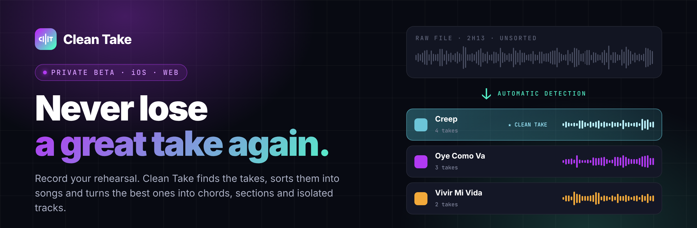
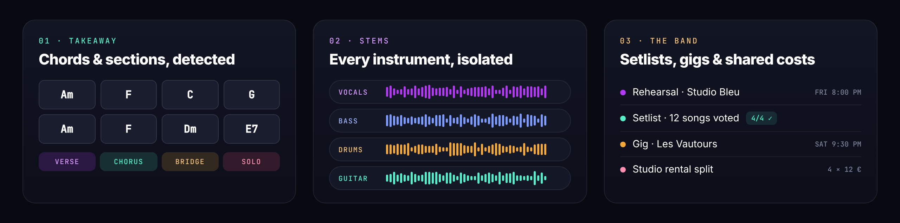

<h2>Hi there, I'm Antoine 👋</h2>

**Freelance CTO & AI architect · Founder of Clean Take · Musician on stage 🎶**

I'm an engineer from Télécom SudParis who has spent ~20 years turning messy ideas into products that actually ship — first as a solution architect at Accenture (ticketing, open payment, mobility), then as CPO/CTO of a data science scale-up, and now as a hands-on builder again.

These days I split my time between **building my own product** and **helping startups** sort out their architecture, their roadmap and their AI strategy. Based in Pantin, just outside Paris 🇫🇷

---

### 🎙️ What I'm building

**[Clean Take](https://www.cleantake.app)** — an app for bands. Record your rehearsal, and it takes care of the rest:

- 🎧 automatic take detection and grouping by song, fully on-device and offline
- 🎼 chord & song-section detection, stem separation, editable song structures
- 📋 setlists, rehearsal & gig scheduling, discussions and shared expenses

iOS app + web app + Python audio backend, all built solo (with Claude as a very patient pair programmer 🤖). TestFlight coming late 2026.

 

### 🧭 What I do for others

- **Fractional CTO / CPTO** — take ownership of the tech, prioritise what matters, build the team
- **AI architecture** — document classification, LLM pipelines, prompt design, evaluation benchmarks, quality monitoring
- **AI-assisted delivery** — bringing agents into design, dev and acceptance testing so small teams move faster
- **Data platforms** — I've designed real-time, spatio-temporal and HR analytics platforms from scratch

---

### 🛠️ Tools I enjoy

**Building now**

  

**Data & cloud background**

  

---

### 🗺️ The road so far

| When | Where | What |
|---|---|---|
| 2026 → | **Clean Take** | Founder — building the whole thing, from audio R&D to App Store |
| 2026 → | **Freelance** (via Astrolabe CAE) | Fractional CTO & AI architect for a legal tech startup |
| 2025 → | **Némia** | Co-founder — pay transparency & AI impact on jobs, powered by payroll data |
| 2016 – 2025 | **Openfield → xCO Analytics** | Projects Director → Product Director → CPO/CTO & board member, through three pivots |
| 2007 – 2016 | **Accenture** | Solution architect & mobility expert — EMV open payment, SaaS ticketing, transport strategy |

---

### 🌱 Things I care about

- ✔️ Products that are robust *and* pleasant to use
- ✔️ Privacy by design (I've been a DPO, it leaves marks)
- ✔️ Using AI where it really helps, and measuring that it does
- ✔️ Open data for climate — see [OpenGeoScales](https://github.com/TonioFr/opengeoscales.github.io), a Data for Good project

---

### 📫 Let's talk

Happy to chat about CTO missions, AI architecture, or why your band should stop recording rehearsals on a phone at the back of the room 🥁

---

⚡ Fun fact: I spent a decade making people tap their transport cards, and now I build tools for people who tap their feet.
